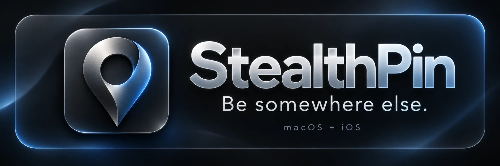

<p align="center"></p>

# StealthPin

StealthPin changes where your iPhone appears in Find My, Maps and every other app. You run it from
your Mac, and the optional StealthPin Remote app lets you drive it from the phone.

This repository only holds the built releases. The source code is private. More about StealthPin is at
[stealthpin.com](https://stealthpin.com).

## What it does

- Set your iPhone's location anywhere on the map, or to a saved bookmark.
- Travel there instead of teleporting: drive, walk or cycle along real roads, taking as long as the
  real trip would.
- Traffic that behaves like traffic: speeds that suit each road, red lights and stop signs, and
  rush-hour stop-and-go, with the route colored by traffic while it drives.
- Natural GPS drift while the phone sits still, so the location doesn't look frozen.
- Replay trips you actually recorded, with their real stops and pace. GPX import and export.
- Back to Real Location from the window, the menu bar, ⇧⌘⌫ or the phone. Restarting the iPhone also
  switches faking off.
- Recents, suggested bookmarks and favorites.

## Requirements

- A Mac running macOS 14 or later.
- An iPhone with **Developer Mode** turned on (Settings › Privacy & Security › Developer Mode). The
  switch is hidden until a Mac asks for it: with the iPhone plugged in by cable and unlocked, click
  **Show the Switch on My iPhone** in StealthPin's setup tour, or run
  `pymobiledevice3 amfi reveal-developer-mode`. No Xcode needed. The
  [step-by-step guide](https://stealthpin.com/developer-mode) explains it in plain language.
- [pymobiledevice3](https://github.com/doronz88/pymobiledevice3), which StealthPin uses to talk to
  the phone:

  ```bash
  uv tool install pymobiledevice3
  ```

## Installing

1. Download the latest `Stealthpin.zip` from [Releases](../../releases).
2. Unzip it and move **StealthPin** to Applications.
3. Connect your iPhone over USB, tap **Trust**, and open StealthPin. A short tour checks each part of
   the setup and walks you through your first move.
4. On iOS 17 and later, click the iPhone button at the top left of the map and choose **Start** to bring
   up the tunnel. It asks for your admin password, because the tunnel has to run as root.

If the macOS firewall is on, allow incoming connections for StealthPin when asked, so the remote can
reach it.

StealthPin Remote, the iPhone app, isn't offered as a download here, because iOS only installs apps
from the App Store, TestFlight or a developer's own build.

## Using it responsibly

StealthPin is for controlling where your own iPhone appears. Faking a location can break the rules of
apps and services that depend on it, so use it with care.

StealthPin isn't affiliated with or endorsed by Apple. Find My, iPhone and macOS are trademarks of
Apple Inc.
